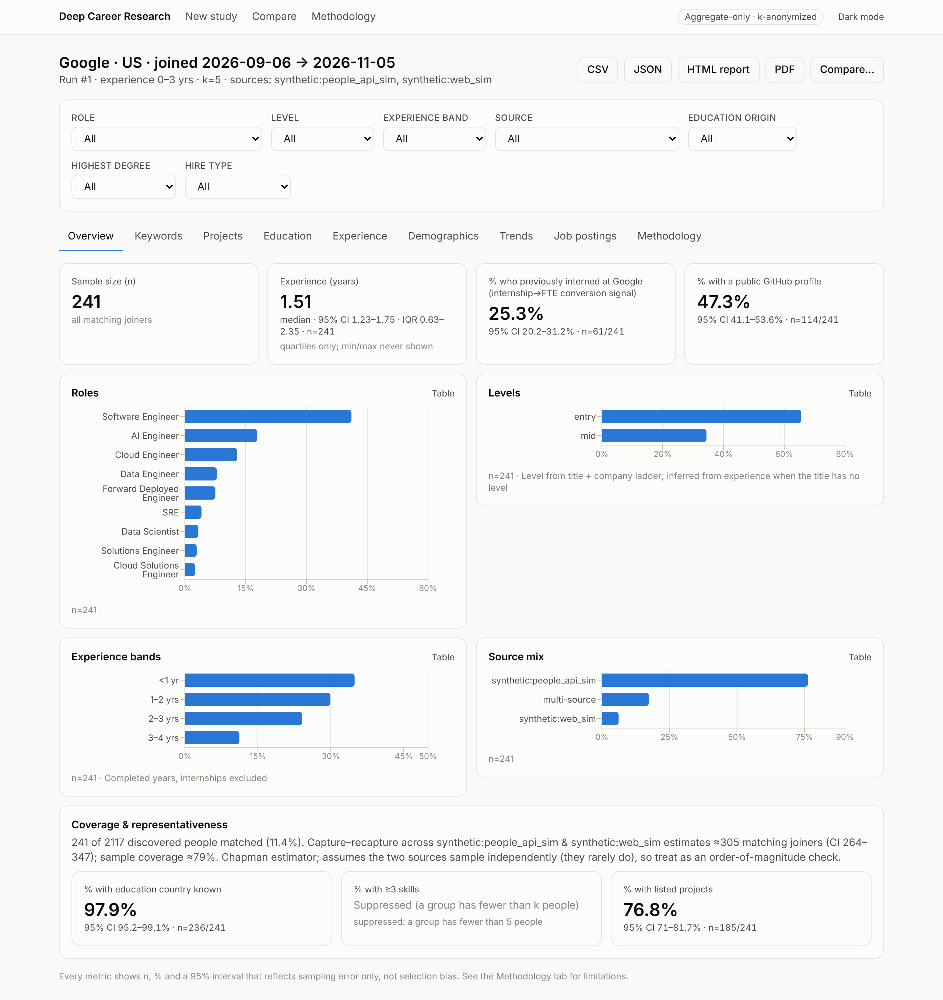

# Deep Career Research

A local-first research app that estimates **hiring trends at a target company** by analyzing publicly
available professional profiles of **recent joiners**. It produces **aggregate statistics only**, never
per-person dossiers.

> Example study: *Google, US, joined in the last 60 days, 0–3 years of experience, roles SDE I/II/III,
> Cloud Engineer, AI Engineer, Forward Deployed Engineer, Data Engineer (+ similar).*



## What you get

- **Study wizard.** Company and aliases, country/regions, join window (30/60/90 days or a custom range),
  experience range, roles with **role expansion** (synonym map + company level ladders + optional LLM
  suggestions) that you confirm before running, sources, sample cap, confidence threshold.
- **Pipeline.** Discover → entity resolution (dedupe across sources, with confidence) → normalization
  (titles → role + level, skills taxonomy, schools, companies) → **audited filter** (why each person
  passed or failed) → LLM enrichment (Claude, structured JSON, validated) → aggregate analytics.
- **Dashboard.** Roles, levels, experience, top skills and distinctive keywords, co-occurrence clusters,
  projects (tags, stacks, personal/academic/professional, GitHub), education (degrees, schools, fields,
  domestic vs. foreign), feeder companies and new-grad vs. lateral hires, internship→FTE signal,
  demographic estimates (pronouns, optional name-based estimate), trend windows, and a job-postings
  cross-check. Every chart can be cross-filtered, and every number shows n, % and a 95% interval.
- **Compare** re-runs of a saved study over time, or different studies.
- **Exports**: aggregate CSV/JSON, an HTML report, PDF, and chart PNGs.
- **CLI** for everything: `dcr run --company Google --country US --days 60 --exp 0-3 --roles roles.yaml`.

## Privacy and ethics (hard rules, enforced in code)

| Rule | How it's enforced |
|---|---|
| Aggregate-only output | The API and exports read only the aggregate layer. No names, photos, profile URLs or per-person rows. Optional *audit mode* shows anonymized IDs and filter reasons only. |
| k-anonymity (k ≥ 5) | Every bucket < k is suppressed, including cross-filter intersections. Complementary suppression stops a hidden cell from being recovered as `total − visible`. A view is also suppressed if it differs from a related view by 1…k−1 people (differencing protection). Every export is re-checked before it is written. |
| Gender | Never inferred from photos. Self-stated pronouns are counted as written. An **optional**, off-by-default name-based estimate is reported only in aggregate, with a confidence interval and an "unknown" bucket, and labeled *ESTIMATE*. |
| International background | Only labeled **proxies** are reported (% whose highest degree was earned abroad, % with prior work abroad). Never "visa status". |
| Sensitive attributes | No inference of race, religion, age, health, etc. LLM prompts forbid it. |
| Data minimization | Names, emails and URLs are scrubbed before any LLM call. |
| Retention | Raw and normalized personal data expires after a configurable TTL (default 30 days) and is purged hourly. Aggregates are kept. |

## Data sources and legal notes

**Zero-key by default.** The app runs without paid data APIs.

| Adapter | Key | What it does | Notes |
|---|---|---|---|
| `manual` | – | CSV/JSON import ([format](docs/import-format.md)) | You must have the right to process the data you import. |
| `synthetic` / `synthetic_jobs` | – | Realistic **fake** profiles and postings | For development, demos and tests. |
| `github` | optional `GITHUB_TOKEN` | Public org members, explicit users, user search; repos → projects/stars | GitHub REST API within its rate limits; public data only. |
| `web_scraper` | – | Public pages from your seed URLs and sitemaps (personal sites, team and speaker pages, "I just joined X" posts) | **Always obeys robots.txt** (unreachable = disallow), honest User-Agent, per-host delays, caching. **Never** logs in, solves CAPTCHAs or evades bot detection. **LinkedIn and other login-walled sites are blocked outright.** |
| `greenhouse`, `lever`, `ashby` | – | Public job-board APIs (complementary signal) | Postings are not personal data. |
| `manual_jobs` | – | CSV/JSON postings import | |
| `pdl` | `PDL_API_KEY` | People Data Labs person search (licensed) | Disabled by default. Follow your PDL contract. |
| `brave` | `BRAVE_API_KEY` | Search-API discovery → robots-respecting fetch | Disabled by default. |
| `x` | `X_BEARER_TOKEN` | Official X API v2 "joined X" posts | Disabled by default. Official API only. |

**Coverage caveat.** Start dates for recent joiners mostly live on professional networks that forbid
scraping. Open-web samples are smaller and skew toward people who post publicly. The coverage panel
(source mix, field completeness, capture–recapture when two sources overlap) and the methodology page say
so explicitly. Adding a new source is one file; see [docs/data-sources.md](docs/data-sources.md).

## Quick start

### Docker (one command)

```bash
cp .env.example .env
```

```bash
docker compose up --build
```

Then open http://localhost:3000. The API and docs are at http://localhost:8000/docs. Ports bind to
127.0.0.1 only, because the app is local-first and has no authentication. Put CSV/JSON imports in
`./data/` and reference them as `manual:/app/data/<file>`.

### Local development

Requires Python 3.12 + [uv](https://docs.astral.sh/uv/) and Node 22.

```bash
cd backend && uv sync --extra pdf
```

```bash
uv run dcr synth --n 2000 --out ../data/synth.json
```

```bash
uv run dcr run --company Google --country US --days 60 --exp 0-3 --roles ../roles.yaml --source manual:../data/synth.json --yes
```

```bash
uv run dcr serve
```

```bash
cd web && npm install && npm run dev
```

### CLI reference

```text
dcr synth        generate fake profiles/postings for development
dcr sources      list adapters, availability and ToS notes
dcr run          run a study (role expansion + cost confirmation; --yes to skip; --save-as NAME)
dcr study list   list saved studies and their runs
dcr study rerun  re-run a saved study (new reference date)
dcr compare      compare 2–3 runs (deltas with significance tests)
dcr export       csv | json | html | pdf | zip(charts), with optional --filter dim=value
dcr purge        delete personal data past TTL (--run-id N to purge one run now)
dcr data fetch-names   build the optional estimator's name table (SSA)
dcr serve        API + background worker
```

Source specs: `--source synthetic:n=2000,seed=1`, `--source manual:data/x.csv`,
`--source web_scraper:seeds=https://a.dev/|https://b.dev/blog`, `--source greenhouse:stripe`,
`--source github:orgs=google`.

## Configuration

- `.env`: secrets (`ANTHROPIC_API_KEY`, `GITHUB_TOKEN`, `PDL_API_KEY`, `BRAVE_API_KEY`, `X_BEARER_TOKEN`, `DATABASE_URL`).
- `config.yaml`: source enablement, rate limits and ToS notes; k-anonymity (minimum 5); TTL; the
  optional estimator; pipeline defaults; LLM model (`claude-opus-5-5` by default), effort, **budget cap**
  and pricing.

**Cost control.** Before a run the CLI and wizard show an LLM cost estimate (an upper bound). Enrichment is
cached by content hash, and once the budget cap is reached the remaining profiles fall back to heuristic
enrichment. Without `ANTHROPIC_API_KEY` everything runs in heuristic mode at zero LLM cost.

**Database.** SQLite by default. For Postgres, set `DATABASE_URL=postgresql+psycopg://…`, install the
`postgres` extra, and run `uv run alembic upgrade head`.

## Architecture

```
backend/src/dcr/
  adapters/    SourceAdapter / JobPostingAdapter, registry, manual, synthetic, github, web_scraper, jobs/, keyed/
  pipeline/    discover, resolve (entity resolution), normalize/, filter (audit), runner, retention (TTL)
  roles/       title parser + company level ladders, role expansion
  enrichment/  Claude client (structured output, fallbacks), schemas, cache, cost, heuristic fallback
  analytics/   engine, kanon, stats, keywords, demographics, store (precomputed views), compare
  api/         FastAPI app;  tasks/ local asyncio queue (DB-persisted, restart-safe)
  exports/     CSV / JSON / HTML / PDF / PNG
web/           Next.js + Tailwind + Recharts: wizard, run progress, dashboard, compare, methodology
```

Storage layers: raw → normalized → enriched (personal, TTL-purged) → aggregates (retained). Reports for
the base view and for every 1- and 2-dimension filter are precomputed and k-anonymized at run end, so
dashboards keep working after raw data is purged.

## Methodology and limitations

See [docs/methodology.md](docs/methodology.md) and the in-app Methodology page. In short: sampling bias
toward people with discoverable public profiles; self-reported, possibly stale data; levels inferred from
titles and company ladders; entity-resolution errors (confidence-scored, low-confidence matches
excluded); confidence intervals cover sampling error only, not selection bias.

## Development

```bash
cd backend && uv run pytest
```

```bash
uv run ruff check src tests && uv run mypy
```

Tests use **synthetic fixture profiles only**, plus mocked HTTP for adapters and a fake LLM client. They
cover normalization, role expansion, dedupe precision/recall, filters, k-anonymity and differencing,
estimators, exports, retention, API and CLI. CI runs lint, types, tests (coverage ≥ 85%), migrations,
the web build and the Docker build.

More screenshots: [docs/screenshots](docs/screenshots).

## License

MIT, see [LICENSE](LICENSE).
